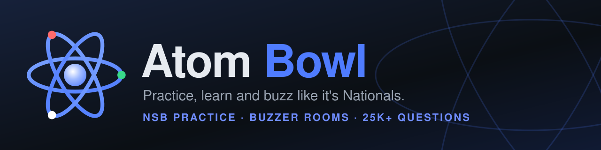
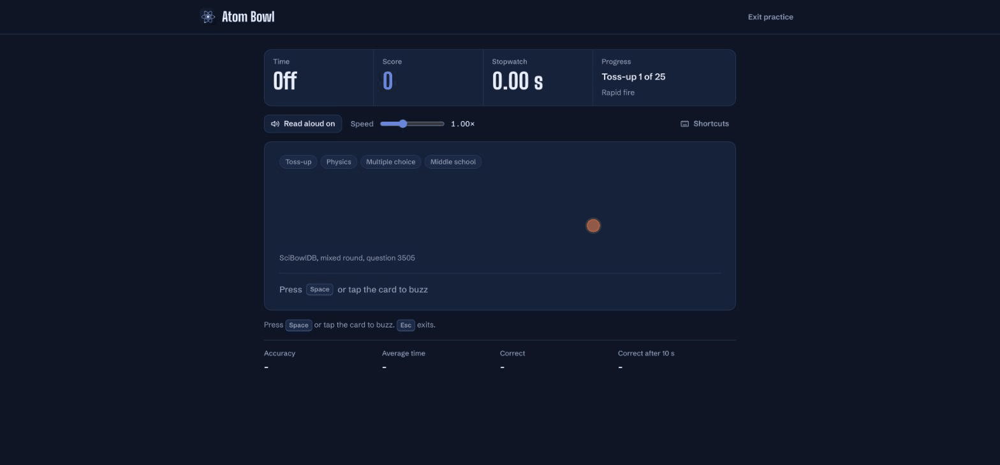

<p align="center">
  
</p>

<p align="center">
  <a href="https://atombowl.web.app"><b>Live site</b></a> ·
  <a href="info_docs.md">How to use</a> ·
  <a href="https://github.com/shankar-sachin/atombowl/wiki">Wiki</a> ·
  <a href="CONTRIBUTING.md">Contribute</a> ·
  <a href="SUPPORT.md">Support</a>
</p>

<p align="center">
  
  
  
</p>

**Atom Bowl** is a fast, clean, browser-based practice platform for the **National Science Bowl (NSB)**. It has 25K+ real questions, 90+ lessons, live NSB-style buzzer rooms and a game clock, all running in the browser with no frameworks.



## Features

- **Practice Engine**: tossup/bonus rounds with a typewriter moderator, interrupts, subtopic filters and NSB scoring.
- **Question Bank**: Bank A (DOE questions, image format) and Bank B (text format), searched and filtered in the browser.
- **Learn**: 90+ lessons across the NSB categories, stored as JSON.
- **Buzzer Rooms**: live rooms with moderator controls, teams and first-buzz resolution, backed by Firestore.
- **Game Clock**: team names, timers, scores and penalties.
- **AtomCorrect** and **AtomScore**: in-browser answer grading and scoring, written in TypeScript.
- **Accounts**: Google and email sign-in through Firebase Authentication.
- Light and dark mode.

Signed-in players also get **Generate** (new toss-ups and bonuses on a topic you pick, playable in practice) and **Tutor** (a chat that explains a missed question), with free daily credits. Coming in v1.0: a Bank C of invitational and regional questions.

## Tech

Plain HTML, CSS and TypeScript (compiled with `tsc`) on Firebase Hosting, Authentication and Firestore. Grading, search and bank tools all run in the browser. The only server code is one Cloud Function (`functions/`) that runs Generate and Tutor: it checks sign-in, charges daily credits and calls the AI model (Gemini or Groq), so the API key never reaches the browser.

## Development

Use Node.js 22 or 24.

```bash
npm ci                                  # install dependencies
npm run build                           # compile src/ts into docs/js and copy HTML/CSS into docs/
npx firebase emulators:start --only hosting   # preview at http://localhost:5000
npm test                                # unit tests
npm run test:firebase                   # Firestore rules tests (needs Java 21+)
```

`docs/` is the built site and is committed. It is the Firebase Hosting public directory. Edit `src/`, never `docs/js`.

Deploy (maintainers only):

```bash
npm run build
npx firebase deploy --only hosting      # https://atombowl.web.app
npx firebase deploy --only firestore:rules
```

See [Firebase setup](src/data/firebase_rules.md) for sign-in providers, authorized domains and rules.

## Contributing

Always open a pull request. Never push to `main`. See [CONTRIBUTING.md](CONTRIBUTING.md). Report security problems as described in [SECURITY.md](SECURITY.md), and read the [Code of Conduct](CODE_OF_CONDUCT.md).

## Credits

- Question Bank A: official DOE questions parsed by @arxenix (sets only, no code).
- Question Bank B: SciBowlDB's question bank.
- Question Bank C: coming from smaller invitationals and niche competitions.

## License

Atom Bowl's original source code is licensed under the [MIT License](LICENSE). Third-party question banks, images and provider artwork keep their own licenses and terms.
